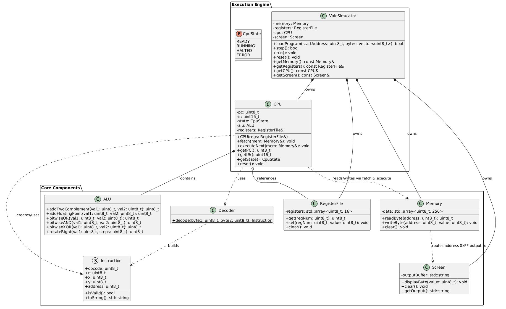

Vole Machine Simulator - Assignment 2 (Part 1)

Course: CS213 Object-Oriented Programming
Section: S33 / S34

Team Members
Mariam Tarig Omer - 20253009
Shahd Abdalelah Osman - 20253012
Mozan Nageeb Mohamed - 20253016
Rana Salah Aldeen Khalid - 20253018

Project Overview
This repository contains our work for Part 1 of Assignment 2. We designed the C++ class architecture for the Vole Machine Simulator and analyzed AI-generated UML design options and tested two custom assembly programs.

Machine Architecture
1. Memory: 256 main memory cells (from 00 to FF). Address FF acts as memory-mapped output to the screen.
2. Registers: 16 general-purpose registers (R0 through RF).
3. CPU: Handles the instruction cycle (Fetch, Decode, Execute) using PC and IR registers.
4. ALU: Executes Two's Complement addition, floating-point addition, and bitwise operations.

Tested Assembly Codes
1. Program 1 (Addition): Loads values 5, 6 and 7 into registers R1, R2, and R3, adds them together, and writes the final sum (0x12) to memory location FF for screen output.
2. Program 2 (Swap): Loads values 0x0A and 0x0B into R1 and R2, swaps their contents using R3 as a temporary register, and stores the result to address FF.

Final UML Diagram

Deliverable Links
Presentation Video: https://drive.google.com/file/d/16K1h1PGa79EUbMnIs6K09A5yaPay6ouB/view?usp=drivesdk
GitHub Repo: https://github.com/mozannageeb20253016/Vole-Machine-Simulator.git
